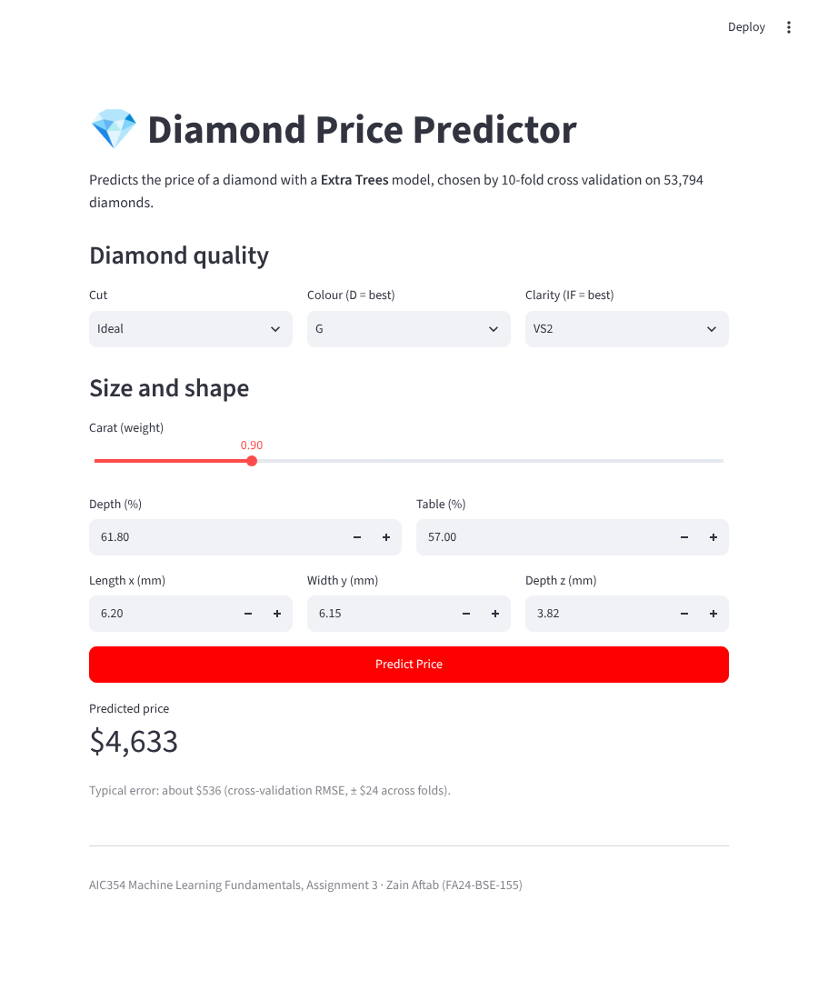
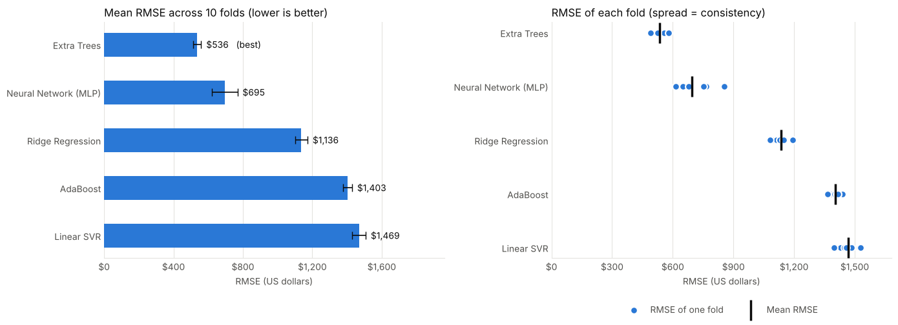

# 💎 Diamond Price Prediction

[](https://zainaftab-diamond-price.streamlit.app)


Machine learning project that predicts the price of a diamond from its carat, cut, colour, clarity and dimensions.
Five regression algorithms are compared with **10-fold cross validation**, and the best one (**Extra Trees**) is deployed as a web app.

### 🔗 Live demo: **https://zainaftab-diamond-price.streamlit.app**



---

## Dataset

The classic `diamonds` dataset from the ggplot2 R package ([CSV source](https://raw.githubusercontent.com/mwaskom/seaborn-data/master/diamonds.csv)).

- **53,940** diamonds, **53,794** after removing duplicate rows
- **Target:** `price` in US dollars (average $3,933)
- **Numeric features:** `carat`, `depth`, `table`, `x`, `y`, `z`
- **Categorical features:** `cut`, `color`, `clarity`

## Method

1. **Preprocessing** in a scikit-learn `Pipeline` + `ColumnTransformer`:
   - numeric features → median imputation + `StandardScaler`
   - categorical features → most-frequent imputation + `OneHotEncoder`
2. **10-fold cross validation** (`KFold`, shuffled, `random_state=42`) on the full dataset, scored with RMSE.
3. **Five algorithms compared:**
   - Ridge Regression
   - Linear SVR
   - Neural Network (MLPRegressor)
   - Extra Trees Regressor
   - AdaBoost Regressor
4. The best model is retrained on all data, saved with `joblib`, and served by a Streamlit app.

## Results

| Rank | Algorithm | Mean RMSE | Std (10 folds) | % of average price |
|:---:|---|---:|---:|---:|
| 🥇 1 | **Extra Trees** | **$536** | $24 | **13.6%** |
| 2 | Neural Network (MLP) | $695 | $74 | 17.7% |
| 3 | Ridge Regression | $1,136 | $36 | 28.9% |
| 4 | AdaBoost | $1,403 | $26 | 35.7% |
| 5 | Linear SVR | $1,469 | $39 | 37.3% |

Extra Trees had the lowest error in **all 10 folds**. It captures the non-linear relationship between carat and price,
and the interactions between cut, colour and clarity, that the linear models miss.



## Project structure

```
diamond_price_model/
├── app.py                         # Streamlit web app
├── diamond_price_model.joblib     # Trained Extra Trees pipeline
├── model_info.json                # Algorithm, CV RMSE, input ranges and categories
├── requirements.txt               # Pinned library versions
├── assets/                        # Images used in this README
└── notebook/
    ├── diamond_price_kfold_full_dataset_10fold.ipynb   # Training + 10-fold CV notebook
    └── diamonds.csv                                    # Dataset
```

## Run locally

```bash
git clone https://github.com/ZainAftab-dev/diamond_price_model.git
cd diamond_price_model
pip install -r requirements.txt
streamlit run app.py
```

To reproduce the training and cross validation, open the notebook in `notebook/` (Jupyter or Google Colab) and run all cells.

## Deployment

The app is deployed on **Streamlit Community Cloud** directly from this repository (`main` branch, `app.py`).
Free apps sleep after a period of inactivity; if you see a "wake up" button, click it and wait a few seconds.

## Author

**Zain Aftab** (FA24-BSE-155)
AIC354 Machine Learning Fundamentals, Assignment 3
